# GoGet - десктопное приложение доставки

**GoGet** - учебный проект системы доставки товаров с тремя ролями (**клиент**, **модератор**, **курьер**), MySQL в Docker, построением маршрута (**Nearest Neighbor + 2-opt**) и картой на Folium.

> Клонировал → Docker Desktop → `start.bat` → готово.

<p align="center">
  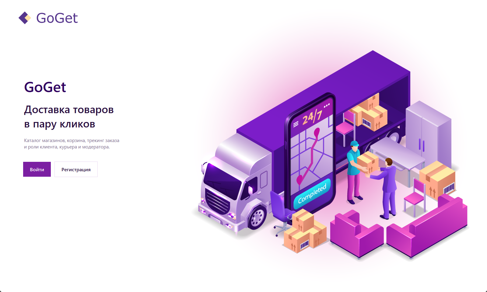
</p>

| | |
|:--|:--|
| **Стек** | Python 3.11+, Tkinter / ttkbootstrap, MySQL 8, Docker, Folium, bcrypt, pytest |
| **БД** | `goget` на порту `3307`, схема и seed в репозитории |
| **Фичи** | каталог → корзина → заказ → назначение курьера → маршрут на карте |
| **Качество** | слоистая структура `app/`, логи, CI, тесты |

Дополнительно: [ARCHITECTURE.md](ARCHITECTURE.md) · [LICENSE](LICENSE)

---

## Содержание

1. [Скриншоты](#скриншоты)
2. [Возможности по ролям](#возможности-по-ролям)
3. [Архитектура](#архитектура)
4. [Алгоритмы](#алгоритмы)
5. [Модель данных](#модель-данных)
6. [Быстрый старт](#быстрый-старт)
7. [Демо-аккаунты](#демо-аккаунты)
8. [Структура репозитория](#структура-репозитория)
9. [Тесты и CI](#тесты-и-ci)
10. [Безопасность](#безопасность)

---

## Скриншоты

Реальные окна приложения (сняты из работающего UI). Обновить: `python scripts/capture_screenshots.py`.

### Главный экран и вход

| Стартовый экран | Вход |
|:--:|:--:|
|  | 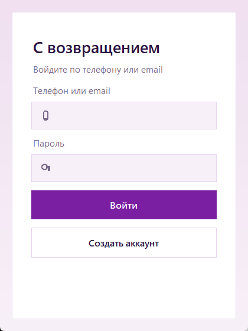 |

### Клиент

Каталог категорий → товары с фото и магазином → корзина.

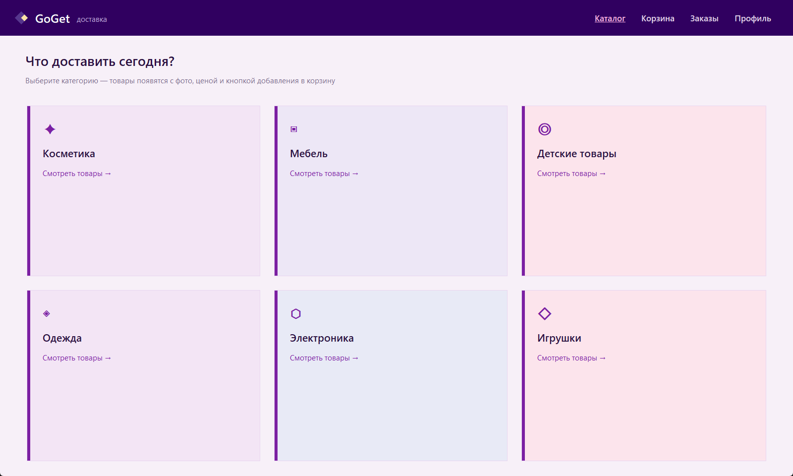

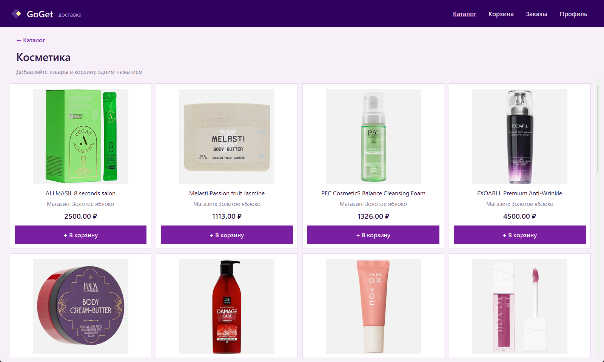

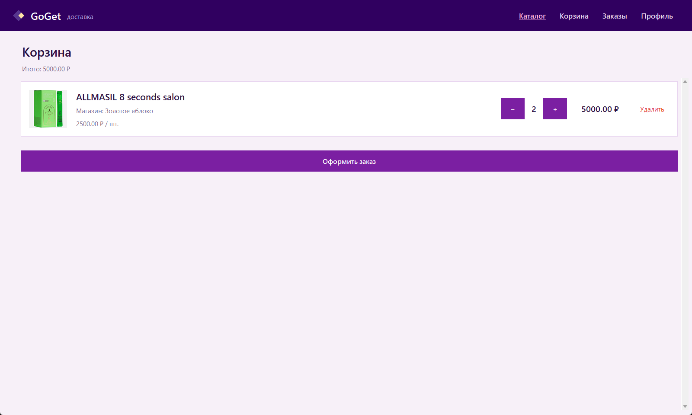

### Модератор

Заказы, пользователи (пароли скрыты), товары.

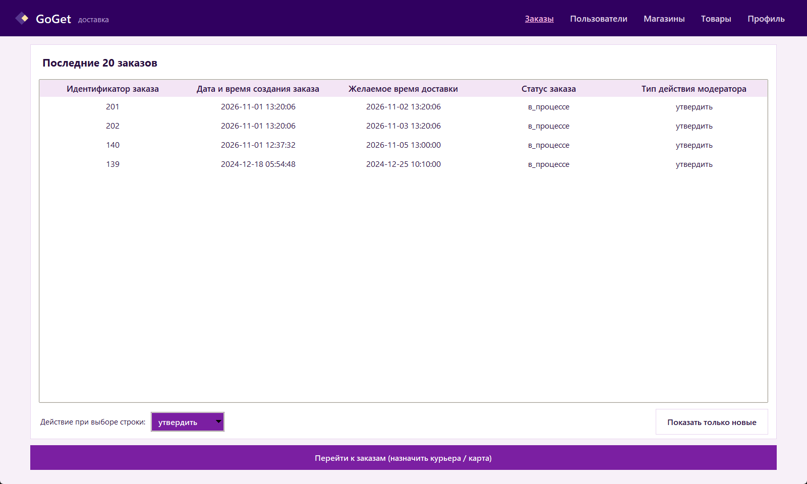

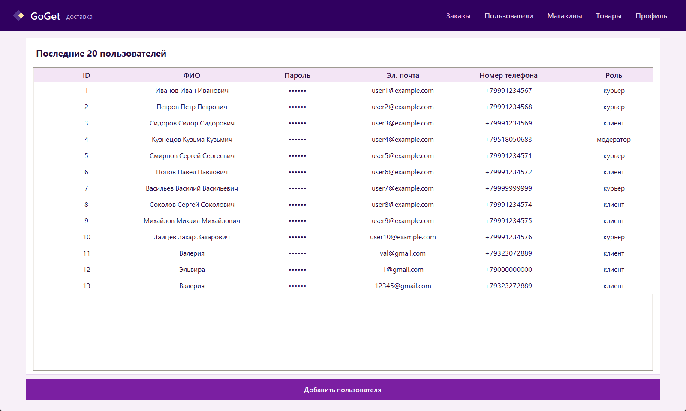

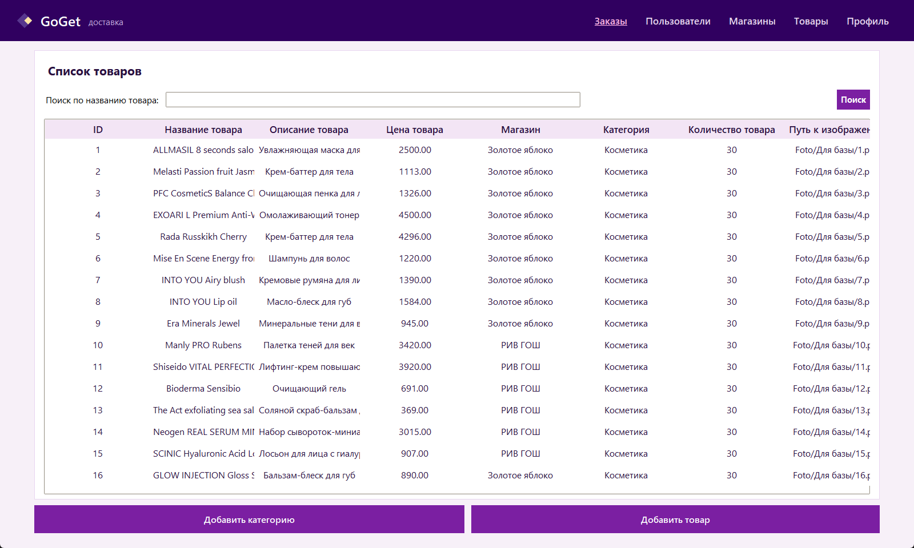

### Курьер

Назначенные заказы (демо: 139, 201, 202) и смена статуса.

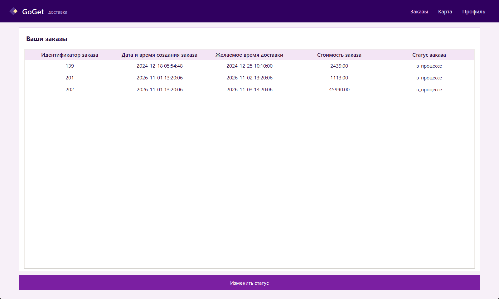

---

## Возможности по ролям

| Роль | Что делает |
|------|------------|
| **Клиент** | Категории и товары (с названием магазина), корзина, оформление заказа, статусы своих заказов |
| **Модератор** | Новые / все заказы, назначение курьера, пользователи, магазины, товары, карта маршрутов |
| **Курьер** | Свои заказы (лимит **2** активных `в_процессе`), смена статуса, карта с точками «забрать / доставить» |

### Жизненный цикл заказа

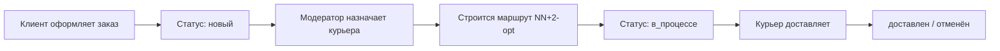

---

## Архитектура

Приложение разделено на слои: UI не ходит в SQL напрямую там, где вынесена бизнес-логика (маршруты, геокод, пароли).

```text
┌─────────────────────────────────────────────────────────┐
│  main.py                                                │
│  app/ui/*          окна клиента / модератора / курьера  │
├─────────────────────────────────────────────────────────┤
│  app/auth/*        bcrypt, регистрация, вход            │
│  app/services/*    маршрутизация, геокод, корзина       │
├─────────────────────────────────────────────────────────┤
│  app/db/*          SQL-запросы                          │
│  app/config/*      MYSQL_* из .env / .env.docker        │
├─────────────────────────────────────────────────────────┤
│  MySQL 8 (Docker)  schema + seed при первом volume      │
└─────────────────────────────────────────────────────────┘
```

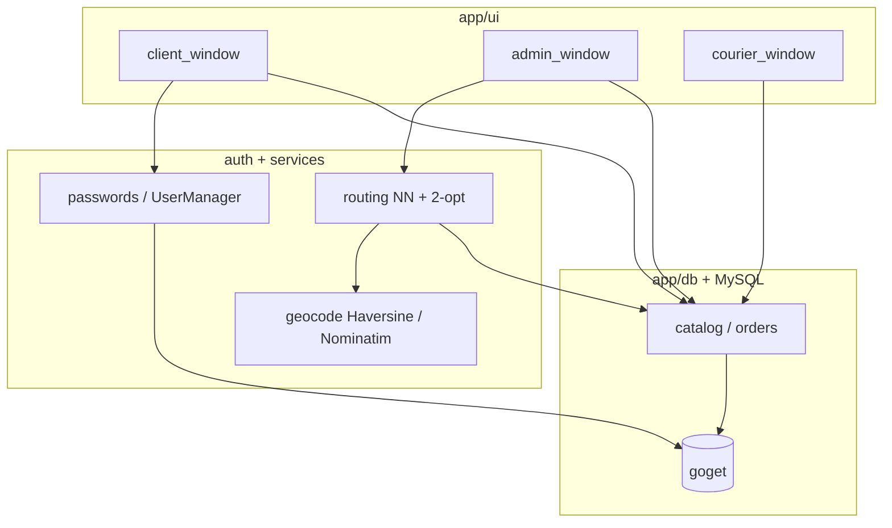

Подробности слоёв и потоков: [ARCHITECTURE.md](ARCHITECTURE.md).

---

## Алгоритмы

Код: [`app/services/routing.py`](app/services/routing.py), геометрия: [`app/services/geocode.py`](app/services/geocode.py).

### 1. Построение маршрута курьера

Заказ может содержать товары из **нескольких магазинов**. Нужно обойти точки «забрать», затем доставить клиенту.

**Шаги:**

1. Собрать адреса магазинов по позициям заказа + адрес доставки.
2. Упорядочить **только заборы** алгоритмом **Nearest Neighbor**, стартуя с каждой точки и выбирая лучший путь.
3. Улучшить путь локальным поиском **2-opt**.
4. Добавить точку **«доставить» всегда в конец** (бизнес-ограничение).
5. Записать `Маршрут` (км, минуты) и `ТочкиМаршрута`.

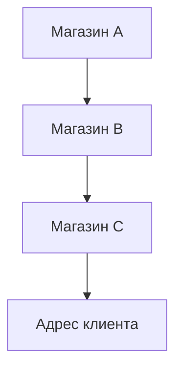

#### Nearest Neighbor (жадный)

Из текущей точки каждый раз выбирается **ближайшая ещё не посещённая**.  
Сложность порядка \(O(n^2)\) по числу точек забора. Хороший быстрый старт для малого \(n\) (в доставке обычно 1-5 магазинов).

#### 2-opt (локальное улучшение)

Пока находятся улучшения, переворачиваются сегменты пути:

\[
\text{path} = a \rightarrow \ldots \rightarrow b \rightarrow \ldots \rightarrow c \rightarrow \ldots
\]

меняется на вариант с разворотом участка \(b..c\), если суммарная длина (Haversine) уменьшилась.

#### Оценка времени

\[
t_{\text{мин}} \approx \frac{\text{дистанция (км)}}{25\,\text{км/ч}} \cdot 60 + 10 \cdot N_{\text{остановок}}
\]

(городская скорость ~25 км/ч + 10 минут на каждую остановку).

### 2. Расстояние между точками

1. Если в строке уже координаты вида `56.83,60.61` - парсим их.
2. Иначе геокодируем адрес через **Nominatim (OSM)** (с кэшем и лимитом 1 req/s).
3. Считаем **Haversine** (км по сфере Земли).

### 3. Нагрузка курьера

Модератор видит только курьеров, у которых число заказов со статусом **`в_процессе` < 2**.  
Так ограничивается одновременная загрузка и маршруты на карте остаются читаемыми.

---

## Модель данных

Основные сущности:

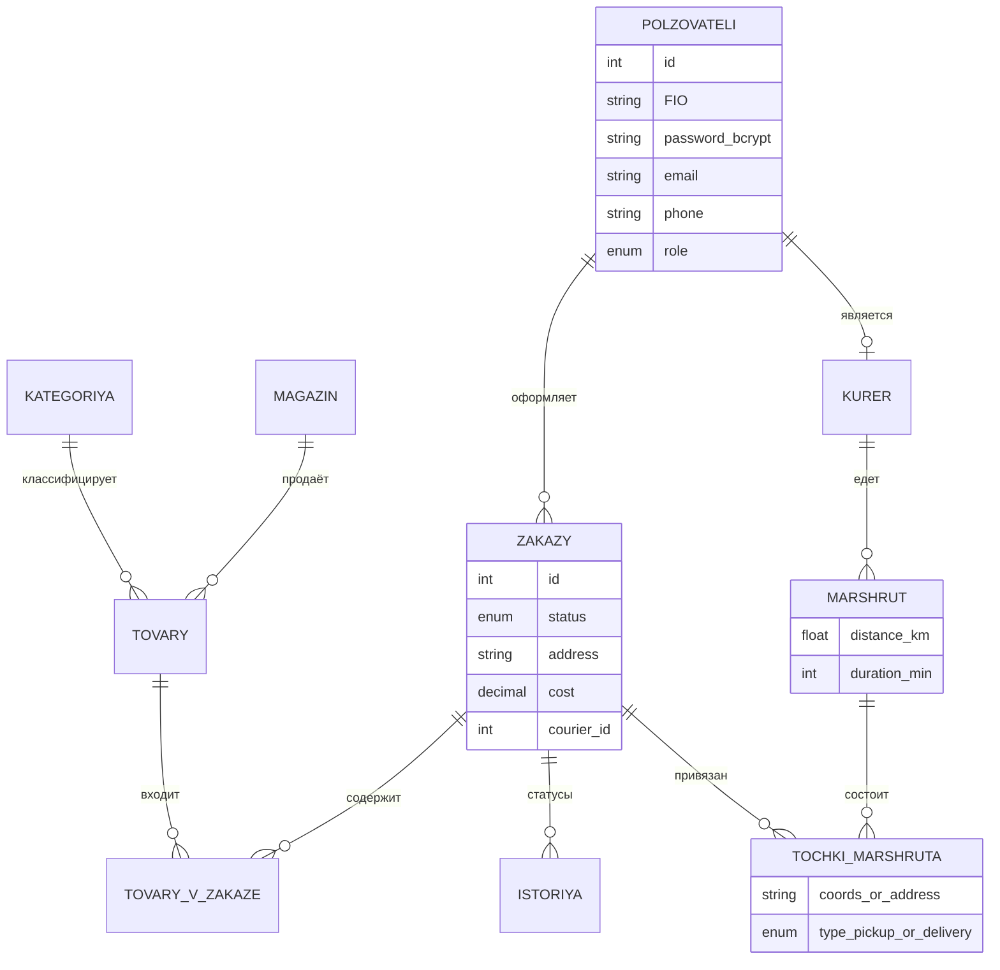

Таблицы в MySQL (русские имена):  
`Пользователи`, `Магазин`, `Категория`, `Товары`, `КатегорияТовары`, `Курьер`, `Заказы`, `ТоварыВЗаказе`, `ИсторияЗаказов`, `Маршрут`, `ТочкиМаршрута`.

Схема и демо-данные: `docker/mysql/init/01_schema.sql`, `02_seed.sql`.

---

## Быстрый старт

### Требования

- [Docker Desktop](https://www.docker.com/products/docker-desktop/) (статус *Running*)
- [Python 3.11+](https://www.python.org/downloads/) с галочкой *Add to PATH*

### Windows - один клик

```text
start.bat
```

или PowerShell:

```powershell
.\start.ps1
```

Скрипт:

1. поднимает MySQL (`docker compose up -d`);
2. ждёт готовности;
3. создаёт `.env` из `.env.docker` при необходимости;
4. ставит зависимости в `.venv`;
5. запускает `scripts/seed_courier_demo.py` (демо-заказы курьера);
6. открывает `main.py`.

### Ручной запуск

```bash
docker compose up -d
copy .env.docker .env
python -m venv .venv
.venv\Scripts\activate
pip install -r requirements.txt
python scripts/seed_courier_demo.py
python main.py
```

Подключение по умолчанию: **`127.0.0.1:3307`**, пользователь / пароль **`goget` / `goget`**, БД **`goget`**.

### Остановка и сброс

```bash
docker compose down          # остановить контейнер
docker compose down -v       # удалить volume → seed применится заново
```

> Seed из `docker/mysql/init/` выполняется **только при первом создании** volume.

---

## Демо-аккаунты

Пароли в БД - **bcrypt**. Для входа используйте plaintext из таблицы:

| Роль | Email | Пароль | Что посмотреть |
|------|-------|--------|----------------|
| Клиент | `client@example.com` | `6` | каталог, корзина, свои заказы |
| Модератор | `user4@example.com` | `4` | назначение курьера, карта, CRUD |
| Курьер | `user1@example.com` | `password1` | статусы, карта с несколькими маршрутами |

После `start.bat` у курьера появляются демо-заказы (в т.ч. **201 / 202** рядом с **139**) - удобно показать карту.

---

## Структура репозитория

```text
main.py                      # точка входа
ARCHITECTURE.md              # краткая архитектура
README.md
requirements.txt
start.bat / start.ps1        # one-click
docker-compose.yml
.env.example / .env.docker

app/
  ui/                        # Tkinter-окна и тема
  auth/                      # bcrypt, UserManager
  services/                  # routing, geocode, cart
  db/                        # connection, catalog, order queries
  config/                    # настройки MySQL
  logging_setup.py           # logs/app.log
  paths.py                   # PROJECT_ROOT, assets/

assets/                      # UI и фото товаров
docs/screenshots/            # картинки для README
docker/mysql/init/           # 01_schema.sql, 02_seed.sql
scripts/                     # init_db, fill_db, seed_courier_demo, generate_seed_sql
tests/                       # pytest
.github/workflows/ci.yml     # CI: MySQL + pytest
logs/                        # runtime-логи (не коммитятся)
```

---

## Тесты и CI

```bash
pytest -q
```

Покрыто:

- подключение и seed (таблицы, категории, товары, магазины);
- логин ролей;
- валидация телефона / email / ФИО;
- геокод / Haversine;
- bcrypt;
- точки маршрута / заказы.

**GitHub Actions** (`.github/workflows/ci.yml`) на push/PR: поднимает MySQL 8, применяет schema+seed, гоняет pytest.

---

## Безопасность

| Тема | Как сделано |
|------|-------------|
| Пароли | bcrypt (`app/auth/passwords.py`); в админке хеш не показывается |
| Legacy | старый plaintext при входе принимается один раз и перехешируется |
| Ошибки | пользователю короткое сообщение; стек - в `logs/app.log` |

---

## Стек

- **UI:** Tkinter, ttkbootstrap, Pillow  
- **БД:** MySQL 8.4 (Docker Compose)  
- **Карты:** Folium + веб-браузер  
- **Гео:** Nominatim OSM, Haversine  
- **Auth:** bcrypt  
- **Качество:** pytest, GitHub Actions, python-dotenv  

---

## Идеи для развития

- REST API (FastAPI) поверх той же БД, UI как клиент  
- Миграции (Alembic) вместо «голых» SQL init  
- OSRM / реальные дорожные расстояния вместо прямой Haversine  
- Больше скриншотов ролей в `docs/screenshots/`

---

## Лицензия

MIT - см. [LICENSE](LICENSE).
